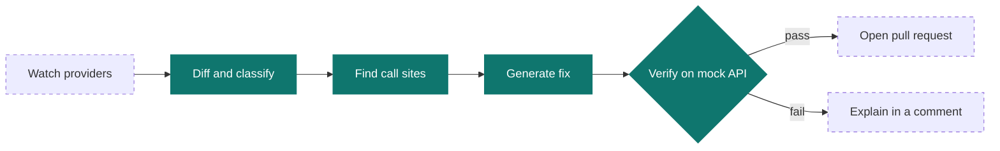

<div align="center">


# apimend

**Dependabot for APIs** — catch breaking API changes before your users do.

[](https://github.com/sarathpanicker07/apimend/actions/workflows/ci.yml)
[](LICENSE)
[](pyproject.toml)
[](https://codespaces.new/sarathpanicker07/apimend)

[Quick start](#quick-start) •
[Usage](#usage) •
[How it works](#how-it-works) •
[Roadmap](#roadmap) •
[Contributing](#contributing)

</div>

---

> [!NOTE]
> apimend is in **early development**. It can detect breaking changes, locate affected code,
> and fix renamed request properties with test verification today. More kinds of fixes are on
> the [roadmap](#roadmap).

## Why apimend?

Your app depends on outside APIs: payments, AI models, messaging and more. When a provider
changes its API, your app can break **without a single line of your code changing** — and
teams usually find out in production.

apimend closes that gap:

| | Capability | Status |
|:-:|---|:-:|
| 🔍 | **Detect** breaking changes between two versions of an API spec | ✅ Available |
| 📍 | **Locate** the exact lines of your code each change affects | ✅ Available |
| 🛠️ | **Fix** the affected code automatically | ✅ Renames |
| ✅ | **Verify** every fix against a mock of the new API before keeping it | ✅ Available |

> [!TIP]
> **What makes apimend different:** a fix is only kept after your tests pass against a mock
> of the new API. If they fail, apimend undoes the fix and shows you why, instead of leaving
> broken code behind.

## Quick start

### Option 1: GitHub Codespaces (recommended)

Click **[Open in Codespaces](https://codespaces.new/sarathpanicker07/apimend)**. The dev
container installs Python, Node.js, [Prism](https://github.com/stoplightio/prism),
[oasdiff](https://github.com/oasdiff/oasdiff) and apimend for you. Then run:

```bash
apimend doctor
apimend diff lab/pizza-api/v1.yaml lab/pizza-api/v2.yaml
apimend scan lab/pizza-api/v1.yaml lab/pizza-api/v2.yaml lab/pizza-api/app
apimend fix  lab/pizza-api/v1.yaml lab/pizza-api/v2.yaml lab/pizza-api/app   # preview only
```

<details>
<summary><strong>Option 2: Install locally</strong></summary>

<br>

Requirements: Python 3.10+, Node.js, and [oasdiff](https://github.com/oasdiff/oasdiff#installation).

```bash
git clone https://github.com/sarathpanicker07/apimend.git
cd apimend
python -m venv .venv && source .venv/bin/activate   # Windows: .venv\Scripts\activate
pip install -e ".[dev]"
npm install -g @stoplight/prism-cli
apimend doctor
```

</details>

## Usage

### `apimend doctor`

Checks that every tool apimend needs is installed.

```console
$ apimend doctor
apimend 0.0.1
python  3.12.11
  [ok]      oasdiff
  [ok]      prism
Everything is ready.
```

### `apimend diff <old-spec> <new-spec>`

Compares two versions of an OpenAPI spec and reports changes that break existing apps.

```console
$ apimend diff lab/pizza-api/v1.yaml lab/pizza-api/v2.yaml
BREAKING CHANGES FOUND:

2 changes: 1 error, 1 warning, 0 info
error   [new-required-request-property] at lab/pizza-api/v2.yaml
        in API POST /orders
                added the new required request property `pizza_size`

warning [request-property-removed] at lab/pizza-api/v2.yaml
        in API POST /orders
                removed the request property `size`
```

#### Exit codes

Designed for scripts and CI pipelines:

| Code | Meaning |
|:-:|---|
| `0` | No breaking changes |
| `1` | Breaking changes found |
| `2` | Could not run (for example, oasdiff is missing or a spec is invalid) |

### `apimend scan <old-spec> <new-spec> [folder]`

Finds the exact lines of Python code affected by breaking changes to request bodies and
endpoints, and spots likely renames.

```console
$ apimend scan lab/pizza-api/v1.yaml lab/pizza-api/v2.yaml lab/pizza-api/app
Scanning lab/pizza-api/app for code affected by 2 breaking change(s)...

POST /orders: request property 'size' was removed
  hint: looks like it was renamed to 'pizza_size'
  lab/pizza-api/app/pizza_client.py:34: return _request("POST", "/orders", {"pizza": pizza, "size": size})

POST /orders: request property 'pizza_size' is now required
  hint: looks like the new name for 'size'
  lab/pizza-api/app/pizza_client.py:34: return _request("POST", "/orders", {"pizza": pizza, "size": size})

Found 1 affected line(s) in 1 file(s).
```

- The folder defaults to the current directory. Skip files with `--exclude "tests/*"`
  (repeatable).
- Code is read with Python's `ast` module, so comments are ignored, and only files that
  reference the endpoint are checked.
- Exit codes: `0` not affected, `1` affected code found, `2` could not run.

> [!IMPORTANT]
> Current limits: scans **Python** files only, checks **request bodies and removed endpoints**
> (not responses yet), and finds endpoints written as plain strings in the code.

### `apimend fix <old-spec> <new-spec> [folder] --test "<command>"`

Fixes affected code and **proves the fix works**: it applies the change, runs your tests
against a [Prism](https://github.com/stoplightio/prism) mock of the **new** API, and keeps the
fix only if they pass.

```console
$ apimend fix lab/pizza-api/v1.yaml lab/pizza-api/v2.yaml lab/pizza-api/app --test "python -m pytest lab/pizza-api/app -q"
Proposed fix (1 line(s)):

--- a/lab/pizza-api/app/pizza_client.py
+++ b/lab/pizza-api/app/pizza_client.py
@@ -31,4 +31,4 @@
 
 def place_order(pizza: str, size: str) -> dict:
     # Written for API v1, which expects the field name "size".
-    return _request("POST", "/orders", {"pizza": pizza, "size": size})
\ No newline at end of file
+    return _request("POST", "/orders", {"pizza": pizza, "pizza_size": size})
\ No newline at end of file

Applying the fix and verifying it with: python -m pytest lab/pizza-api/app -q
Tests will run against a mock of lab/pizza-api/v2.yaml on port 4010.

VERIFIED: the tests passed, so the fix has been kept.
Review the change with 'git diff' before committing it.
```

| Option | Meaning |
|---|---|
| `--test "<command>"` | Command that runs your tests. **Without it, `fix` only previews** and changes nothing. |
| `--port <number>` | Port for the mock server (default `4010`). The URL is also passed to your tests as `APIMEND_MOCK_URL`. |
| `--no-mock` | Run the tests without starting a mock server. |
| `--exclude "<pattern>"` | Skip matching files, as in `scan`. |

**Safety first:**

- Only the exact characters that need changing are edited — quote style, comments, spacing,
  line endings and non-English text are preserved.
- If the tests fail, a setup problem occurs (busy port, Prism missing), or you press
  <kbd>Ctrl</kbd>+<kbd>C</kbd>, every file is restored byte for byte.
- Exit codes: `0` fixed and verified (or nothing to fix), `1` preview only or tests failed,
  `2` could not run.

> [!NOTE]
> `fix` currently repairs **renamed request properties** in Python code (dictionary keys such
> as `{"size": ...}` and lookups such as `body["size"]`). It only acts when the rename is
> unambiguous.

## How it works



<sub>Solid: available today · Dashed: planned</sub>

## The Pizza API lab

`lab/pizza-api/` is a small, controlled test bed for developing apimend:

| Path | Purpose |
|---|---|
| `v1.yaml` | The original API: orders take a `size` field |
| `v2.yaml` | The new API: `size` was renamed to `pizza_size` — a realistic breaking change |
| `app/` | A tiny customer app written for v1, with tests |

<details>
<summary><strong>Reproduce the breakage yourself</strong></summary>

<br>

Use two terminals:

```bash
# Terminal 1 — run a fake v1 API
prism mock lab/pizza-api/v1.yaml

# Terminal 2 — the app works
python -m pytest lab/pizza-api/app -v     # 2 passed
```

Stop Prism (<kbd>Ctrl</kbd>+<kbd>C</kbd>), start it again with `v2.yaml`, and rerun the tests.
The order test now fails with `HTTP Error 422` — the app broke without any change to its code.

Stop Prism again, then let apimend repair the app and prove the repair works:

```bash
apimend fix lab/pizza-api/v1.yaml lab/pizza-api/v2.yaml lab/pizza-api/app --test "python -m pytest lab/pizza-api/app -q"
git restore lab/pizza-api/app/pizza_client.py   # put the lab back for next time
```

</details>

## Development

```bash
pip install -e ".[dev]"   # already done in Codespaces
pytest -v                 # run the test suite
ruff check .              # lint
```

Every push and pull request runs the same checks in
[GitHub Actions](.github/workflows/ci.yml).

<details>
<summary><strong>Project layout</strong></summary>

<br>

```text
apimend/
├── .devcontainer/        Codespaces setup (installs everything automatically)
├── .github/workflows/    CI configuration
├── assets/               Logo and images
├── lab/pizza-api/        Test bed: fake API versions and a customer app
├── src/apimend/          The apimend package
│   ├── __init__.py
│   ├── cli.py            Command-line interface (doctor, diff, scan, fix)
│   ├── fix.py            Applies fixes and verifies them with your tests
│   └── scan.py           Finds code affected by breaking changes
├── tests/                Tests for apimend itself
└── pyproject.toml        Package metadata and tool settings
```

</details>

## Roadmap

- [x] Detect breaking changes between two OpenAPI specs (`apimend diff`)
- [x] Environment checks (`apimend doctor`), test suite, dev container and CI
- [x] `apimend scan` — find the exact lines of Python code a breaking change affects
- [x] `apimend fix` — fix renamed request properties and verify against a mock of the new API
- [ ] More automatic fixes (for example AI-assisted), kept behind the same test gate
- [ ] `scan` support for more languages (JavaScript/TypeScript) and response changes
- [ ] Real-world benchmark using past API migrations from public repositories
- [ ] GitHub Action / App that opens verified pull requests automatically

## Contributing

Ideas, bug reports and pull requests are welcome!

1. Open an [issue](https://github.com/sarathpanicker07/apimend/issues) to discuss larger changes first.
2. Fork the repo and open it in Codespaces — everything is set up for you.
3. Make sure `pytest` and `ruff check .` pass before opening a pull request.

## License

Distributed under the [Apache License 2.0](LICENSE).

<div align="center">
<br>
<sub>If apimend saves you from a broken deploy, consider giving it a ⭐</sub>
</div>
