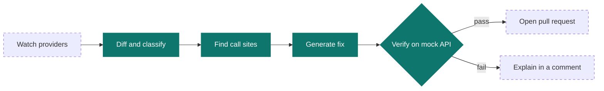

<div align="center">


# apimend

**Catch breaking OpenAPI changes in your code — and fix them safely.**

[](https://github.com/RedHairPirates007/apimend/actions/workflows/ci.yml)
[](https://github.com/RedHairPirates007/apimend/releases)
[](LICENSE)
[](pyproject.toml)
[](https://codespaces.new/RedHairPirates007/apimend)

[Quick start](#quick-start) •
[Usage](#usage) •
[How it works](#how-it-works) •
[Roadmap](#roadmap) •
[Contributing](#contributing)

<br><br>



</div>

---

> [!NOTE]
> apimend is in **early development**. Today it is a command-line tool: you give it two
> versions of an OpenAPI spec, and it finds and fixes affected **Python** code. See
> [what works today](#what-works-today) for the exact scope.
>
> **Vision:** a "Dependabot for APIs" that watches the APIs you depend on and opens verified
> pull requests automatically. That experience is on the [roadmap](#roadmap), not built yet.

## Why apimend?

Your app depends on outside APIs: payments, AI models, messaging and more. When a provider
changes its API, your app can break **without a single line of your code changing** — and
teams usually find out in production.

apimend aims to close that gap.

### What works today

| Capability | Status | Scope today |
|---|:-:|---|
| Compare two OpenAPI specs | ✅ Available | Specs you provide (YAML or JSON) |
| Detect breaking changes | ✅ Available | Via [oasdiff](https://github.com/oasdiff/oasdiff) |
| Find affected code | ✅ Available | **Python only**; request bodies and removed endpoints; each request and its body checked on its own; every line rated high / medium / low confidence |
| Detect renamed properties | 🟡 Limited | One removed + one new required property on the same endpoint |
| Fix code automatically | 🟡 Limited | Renamed request properties only |
| Verify fixes | ✅ Available | Records every request your tests send to a **mock generated from the new spec** and checks it matches — not the live API |
| JSON output for scripts and agents | ✅ Available | `scan` and `fix` with `--format json` |
| JavaScript / TypeScript and other languages | 🗺️ Roadmap | |
| Response-change detection | 🗺️ Roadmap | |
| Automatic pull requests | 🗺️ Roadmap | |
| Provider monitoring | 🗺️ Roadmap | You currently supply both spec versions yourself |

> [!TIP]
> **What makes apimend different:** a fix is only kept after your tests pass against a mock
> of the new API. If they fail, apimend undoes the fix and shows you why, instead of leaving
> broken code behind.

## Quick start

### Option 1: GitHub Codespaces (recommended)

Click **[Open in Codespaces](https://codespaces.new/RedHairPirates007/apimend)**. The dev
container installs Python, Node.js, [Prism](https://github.com/stoplightio/prism),
[oasdiff](https://github.com/oasdiff/oasdiff) and apimend for you. Then run:

```bash
apimend doctor
apimend diff lab/pizza-api/v1.yaml lab/pizza-api/v2.yaml
apimend scan lab/pizza-api/v1.yaml lab/pizza-api/v2.yaml lab/pizza-api/app
apimend fix  lab/pizza-api/v1.yaml lab/pizza-api/v2.yaml lab/pizza-api/app   # preview only
```

<details>
<summary><strong>Option 2: Install locally</strong></summary>

<br>

Requirements: Python 3.10+, Node.js, and [oasdiff](https://github.com/oasdiff/oasdiff#installation).

```bash
git clone https://github.com/RedHairPirates007/apimend.git
cd apimend
python -m venv .venv && source .venv/bin/activate   # Windows: .venv\Scripts\activate
pip install -e ".[dev]"
npm install -g @stoplight/prism-cli
apimend doctor
```

</details>

## Usage

### `apimend doctor`

Checks that every tool apimend needs is installed.

```console
$ apimend doctor
apimend 0.1.1
python  3.12.11
  [ok]      oasdiff
  [ok]      prism
Everything is ready.
```

### `apimend diff <old-spec> <new-spec>`

Compares two versions of an OpenAPI spec and reports changes that break existing apps.

```console
$ apimend diff lab/pizza-api/v1.yaml lab/pizza-api/v2.yaml
BREAKING CHANGES FOUND:

2 changes: 1 error, 1 warning, 0 info
error   [new-required-request-property] at lab/pizza-api/v2.yaml
        in API POST /orders
                added the new required request property `pizza_size`

warning [request-property-removed] at lab/pizza-api/v2.yaml
        in API POST /orders
                removed the request property `size`
```

#### Exit codes

Designed for scripts and CI pipelines:

| Code | Meaning |
|:-:|---|
| `0` | No breaking changes |
| `1` | Breaking changes found |
| `2` | Could not run (for example, oasdiff is missing or a spec is invalid) |

### `apimend scan <old-spec> <new-spec> [folder]`

Finds the exact lines of Python code affected by breaking changes to request bodies and
endpoints, and spots likely renames.

```console
$ apimend scan lab/pizza-api/v1.yaml lab/pizza-api/v2.yaml lab/pizza-api/app
Scanning lab/pizza-api/app for code affected by 2 breaking change(s)...

POST /orders: request property 'size' was removed
  hint: looks like it was renamed to 'pizza_size'
  [high]   lab/pizza-api/app/pizza_client.py:34: return _request("POST", "/orders", {"pizza": pizza, "size": size})

POST /orders: request property 'pizza_size' is now required
  hint: looks like the new name for 'size'
  [high]   lab/pizza-api/app/pizza_client.py:34: return _request("POST", "/orders", {"pizza": pizza, "size": size})

Found 1 affected line(s) in 1 file(s): 1 high, 0 medium, 0 low confidence.
```

- The folder defaults to the current directory. Skip files with `--exclude "tests/*"`
  (repeatable).
- Every line gets a **confidence level**, with the reasons whenever it is not high (see
  below). Show only the lines you trust with `--min-confidence medium` or `high`.
- Code is read with Python's `ast` module, so comments are ignored, and only files that
  reference the endpoint are checked.
- Exit codes: `0` not affected, `1` affected code found, `2` could not run.

**How apimend finds affected code.** It looks at every **request** in your Python files, such
as `requests.post("/orders", json=body)` or your own `_request("POST", "/orders", body)`, and
works out the HTTP method, the path and the **body that request sends**. Each request is
checked on its own, so a property sent by one request never makes another look correct,
and a dictionary that is not part of the request (a log message, analytics, a database
row) is never reported as affected.

apimend traces a request body through:

| Pattern | Example |
|---|---|
| A dictionary passed directly | `requests.post("/orders", json={"size": size})` |
| A variable assigned once | `body = {"size": size}` … `post("/orders", json=body)` |
| Keys added to that variable | `body["size"] = size` |
| A function in the same file that returns a dictionary | `post("/orders", json=make_body(size))` |
| JSON encoding | `Request(url, data=json.dumps(body).encode())` |

It understands `requests`, `httpx`, `aiohttp`, `urllib` and your own wrapper functions,
including URLs built with f-strings, `+` or a constant.

**Order matters.** Only data set *before* a request is part of it: a key added after
`post(...)` was never sent, so it is never reported or changed. A key added only in some
cases (inside an `if`, or later in a retry loop) may be sent, so it is `medium` at most.

| Level | Meaning |
|---|---|
| `high` | **Proven:** part of what a request to the changed endpoint sends, with the same HTTP method and the exact path |
| `medium` | **Probable:** it belongs to a request to the endpoint, but the HTTP method could not be determined, or the path only partly matches (paths with `{parameters}`) |
| `low` | **Uncertain:** apimend could not connect it to the request, for example because the body comes from a function parameter or is changed with `update()` |

Requests that use a **different HTTP method** (for example `GET /orders` when `POST /orders`
changed) are a different operation and are not reported. When something cannot be checked,
apimend says so with the reason, instead of silently skipping it.

> [!IMPORTANT]
> Current limits: scans **Python** files only, and checks **request bodies and removed
> endpoints** (not query parameters, headers or responses yet). Bodies built in another file,
> or passed in as a function parameter, cannot be traced yet and are reported as `low`.
> Files apimend cannot read (for example, with a syntax error) are listed with a warning,
> never skipped silently.

### `apimend fix <old-spec> <new-spec> [folder] --test "<command>"`

Fixes affected code and **checks the fix**: it applies the change, runs your tests against a
[Prism](https://github.com/stoplightio/prism) mock of the **new** API, and records every request
your tests send. The fix is kept only if the tests pass **and** every request matches the new
spec.

```console
$ apimend fix lab/pizza-api/v1.yaml lab/pizza-api/v2.yaml lab/pizza-api/app --test "python -m pytest lab/pizza-api/app -q"
Proposed fix (1 line(s), high confidence or above):

--- a/lab/pizza-api/app/pizza_client.py
+++ b/lab/pizza-api/app/pizza_client.py
@@ -31,4 +31,4 @@
 
 def place_order(pizza: str, size: str) -> dict:
     # Written for API v1, which expects the field name "size".
-    return _request("POST", "/orders", {"pizza": pizza, "size": size})
\ No newline at end of file
+    return _request("POST", "/orders", {"pizza": pizza, "pizza_size": size})
\ No newline at end of file

Applying the fix and verifying it with: python -m pytest lab/pizza-api/app -q
Tests will run against a mock of lab/pizza-api/v2.yaml on port 4010.

Verification report
  [passed] Tests
  [passed] Contract: 2 request(s) reached the mock, all matched the spec
             GET /menu -> 200: matches the new spec
             POST /orders -> 201: matches the new spec
  [passed] Coverage: your tests called every affected endpoint (POST /orders)
  [passed] Re-scan: no affected code remains with the fix applied
  [not checked] Live API behaviour: authentication, rate limits, real data and errors

VERIFIED against the new spec: the fix has been kept.
Review the change with 'git diff' before committing it.
```

| Option | Meaning |
|---|---|
| `--test "<command>"` | Command that runs your tests. **Without it, `fix` only previews** and changes nothing. |
| `--port <number>` | Port for the mock server (default `4010`). The URL is also passed to your tests as `APIMEND_MOCK_URL`. |
| `--no-mock` | Run the tests without starting a mock server (requests are then not checked). |
| `--allow-unverified` | Keep the fix even if your tests never called the mock API. |
| `--min-confidence <level>` | Only change lines found with at least this confidence (default `high`). Lines below it are listed for you to review. |
| `--exclude "<pattern>"` | Skip matching files, as in `scan`. |

**Safety first:**

- By default only lines found with **high confidence** are changed. Anything less certain is
  listed with the reason, for you to review (or to include with `--min-confidence medium`).
- Only the exact characters that need changing are edited — quote style, comments, spacing,
  line endings and non-English text are preserved.
- apimend only changes ordinary files inside the folder you give it. Symbolic links are never
  followed (they are listed as not analysed), every file is checked again right before it is
  written, and if any file is unsafe nothing is changed.
- If the tests fail, a setup problem occurs (busy port, Prism missing), or you press
  <kbd>Ctrl</kbd>+<kbd>C</kbd>, every file is restored byte for byte.
- Exit codes: `0` the fix is verified and complete (or nothing to fix), `1` preview only,
  the fix was undone, or it is only partially verified, `2` could not run.

**The verification report** lists exactly what was checked:

| Check | Passes when |
|---|---|
| Tests | Your test command succeeds |
| Contract | Your tests sent at least one request to the mock, and **every** request matched the new spec |
| Coverage | Your tests called **every** endpoint with affected code (for example `POST /orders`) |
| Re-scan | No affected code remains with the fix applied |
| Live API behaviour | **Never checked** — authentication, rate limits, real data and errors can differ |

| Result | Meaning | Fix kept? |
|---|---|:-:|
| `VERIFIED` | Tests passed, every request matched the new spec, every affected endpoint was called, and no affected code remains | ✅ |
| `PARTIALLY VERIFIED` | What was tested is correct, but an affected endpoint was never called, or affected code remains | ✅ if every request the fix **changed** was tested, otherwise ❌ (✅ with `--allow-unverified`) |
| `TESTS PASSED` | Tests passed; requests were not checked (`--no-mock`) | ✅ |
| `UNVERIFIED` | Tests passed but never called the API | ❌ (✅ with `--allow-unverified`) |
| `NOT VERIFIED` | Tests failed, or a request did not match the new spec | ❌ |

> [!NOTE]
> `fix` currently repairs **renamed request properties** in Python code (dictionary keys such
> as `{"size": ...}` and lookups such as `body["size"]`). It only acts when the rename is
> unambiguous.

> [!WARNING]
> **What `VERIFIED` means:** your tests passed, every request they sent matched the new spec,
> they called every endpoint with affected code, and no affected code remains. It does **not**
> prove the fix works against the live provider — authentication, rate limits, real error
> responses and data can differ from what the spec describes. Coverage is checked per
> endpoint: if two places in your code call the same endpoint, one test call counts for both.

### JSON output for scripts and AI agents

Add `--format json` to `scan` or `fix` to get one JSON document on standard output instead of
text, for CI jobs, scripts and AI agents. Standard output then contains **only** the JSON, even
when something goes wrong; error messages are also printed to standard error. The exit codes do
not change.

```bash
apimend scan lab/pizza-api/v1.yaml lab/pizza-api/v2.yaml lab/pizza-api --format json
```

```json
{
  "schema_version": 1,
  "tool": {"name": "apimend", "version": "0.1.1"},
  "command": "scan",
  "inputs": {"old_spec": "lab/pizza-api/v1.yaml", "new_spec": "lab/pizza-api/v2.yaml", "...": "..."},
  "result": "affected",
  "changes": [
    {
      "kind": "removed-property",
      "method": "POST",
      "path": "/orders",
      "property": "size",
      "description": "POST /orders: request property 'size' was removed",
      "hint": "looks like it was renamed to 'pizza_size'",
      "usages": [
        {
          "file": "lab/pizza-api/app/pizza_client.py",
          "line": 34,
          "code": "return _request(\"POST\", \"/orders\", {\"pizza\": pizza, \"size\": size})",
          "confidence": "high",
          "reasons": []
        }
      ],
      "hidden_usages": 0
    }
  ],
  "unreadable_files": [],
  "summary": {"affected_lines": 1, "affected_files": 1, "by_confidence": {"high": 1, "medium": 0, "low": 0}, "hidden_lines": 0},
  "exit_code": 1
}
```

(Shortened: the real output lists both changes and is indented.)

Every document has `schema_version`, `tool`, `command`, `inputs`, `result` and `exit_code`.
`schema_version` goes up whenever a field is renamed or removed.

| `result` | Command | Meaning |
|---|---|---|
| `no-changes` | scan, fix | The specs have no breaking request changes |
| `not-affected` | scan, fix | No affected code was found (check `unreadable_files`) |
| `affected` | scan | Affected code was found: see `changes[].usages` |
| `preview` | fix | `edits` lists the proposed fix; no files were changed |
| `below-confidence` | fix | Lines were found, but none confident enough to change: see `skipped` |
| `no-automatic-fix` | fix | Your code is affected, but apimend has no automatic fix for it yet |
| `verified`, `partially-verified`, `tests-only`, `unverified`, `failed` | fix | The verdict; `verification` holds the full report and `files_changed` says whether the fix was kept |
| `error` | scan, fix | apimend could not run: see `error` |

For `fix`, `verification` contains every request your tests sent to the mock and whether it
matched the new spec, the affected and changed endpoints (and which ones your tests never
called), the number of affected lines remaining, and the last 50 lines of the test output.
With `--no-mock` no requests are recorded, so the "never called" lists are `null` (unknown).

## How it works



<sub>Solid: available today · Dashed: planned</sub>

## The Pizza API lab

`lab/pizza-api/` is a small, controlled test bed for developing apimend:

| Path | Purpose |
|---|---|
| `v1.yaml` | The original API: orders take a `size` field |
| `v2.yaml` | The new API: `size` was renamed to `pizza_size` — a realistic breaking change |
| `app/` | A tiny customer app written for v1, with tests |

<details>
<summary><strong>Reproduce the breakage yourself</strong></summary>

<br>

Use two terminals:

```bash
# Terminal 1 — run a fake v1 API
prism mock lab/pizza-api/v1.yaml

# Terminal 2 — the app works
python -m pytest lab/pizza-api/app -v     # 2 passed
```

Stop Prism (<kbd>Ctrl</kbd>+<kbd>C</kbd>), start it again with `v2.yaml`, and rerun the tests.
The order test now fails with `HTTP Error 422` — the app broke without any change to its code.

Stop Prism again, then let apimend repair the app and check the repair against the v2 mock:

```bash
apimend fix lab/pizza-api/v1.yaml lab/pizza-api/v2.yaml lab/pizza-api/app --test "python -m pytest lab/pizza-api/app -q"
git restore lab/pizza-api/app/pizza_client.py   # put the lab back for next time
```

</details>

## Development

```bash
pip install -e ".[dev]"   # already done in Codespaces
pytest -v                 # run the test suite
ruff check .              # lint
```

Every push and pull request runs the same checks in
[GitHub Actions](.github/workflows/ci.yml).

<details>
<summary><strong>Project layout</strong></summary>

<br>

```text
apimend/
├── .devcontainer/        Codespaces setup (installs everything automatically)
├── .github/workflows/    CI configuration
├── assets/               Logo and images
├── lab/pizza-api/        Test bed: fake API versions and a customer app
├── src/apimend/          The apimend package
│   ├── __init__.py
│   ├── callsites.py      Finds each request in Python code and the body it sends
│   ├── cli.py            Command-line interface (doctor, diff, scan, fix)
│   ├── fix.py            Plans and applies fixes, undoing them unless verified
│   ├── scan.py           Finds code affected by breaking changes
│   └── verify.py         Mock server, request recording and verification reports
├── tests/                Tests for apimend itself
└── pyproject.toml        Package metadata and tool settings
```

</details>

## Roadmap

**v0.1 — Core loop (done)**

- [x] Detect breaking changes between two OpenAPI specs (`apimend diff`)
- [x] Find affected Python code (`apimend scan`) and fix renamed request properties (`apimend fix`)
- [x] Test suite, dev container, CI and honest documentation of scope

**v0.2 — Trust and correctness** (in progress)

- [x] Verification reports that show what was actually checked (requests that reached the
      mock, whether they matched the spec) and never over-claim
- [x] Confidence scores for affected code (high / medium / low)
- [x] Security hardening: security policy, Dependabot, CodeQL, pinned and verified tools
- [x] Request-level analysis: each request and its body checked on its own (fixes unrelated
      dictionaries being reported, and missing properties being hidden)
- [x] Execution-order-aware tracking (only data set before a request counts), and files that
      cannot be analysed are reported instead of skipped
- [x] Honest verification verdicts: `VERIFIED` needs every affected endpoint called and nothing
      left to fix; otherwise `PARTIALLY VERIFIED`
- [x] JSON output (`--format json`) for scripts, CI and AI agents
- [ ] Repair safety (proven / probable / uncertain) and stricter rename detection (types,
      enums, formats)
- [ ] A first benchmark measuring precision, recall and wrong automatic repairs

**v0.3 — Better code intelligence**

- [ ] Data flow across functions and files, and a documented HTTP-client compatibility matrix
- [ ] Reporting of dynamic URLs that cannot be resolved
- [ ] Language-adapter architecture, so new languages plug into the same core

**v0.4 — Professional OpenAPI support**

- [ ] Query, path and header parameters; form data; nested schemas; external references
- [ ] Response-change detection

**v0.5 — Production readiness**

- [ ] Real-world benchmark with published results, crash-safe repairs

**v0.6 — GitHub and CI integration**

- [ ] GitHub Action that comments on pull requests and opens verified fix pull requests

**Later**

- [ ] JavaScript / TypeScript, then Go, Java and C#
- [ ] Provider monitoring: detect new API versions automatically
- [ ] Optional verification against a provider's sandbox environment
- [ ] More automatic fixes (including AI-assisted), kept behind the same verification gate

## Contributing

Ideas, bug reports and pull requests are welcome!

1. Open an [issue](https://github.com/RedHairPirates007/apimend/issues) to discuss larger changes first.
2. Fork the repo and open it in Codespaces — everything is set up for you.
3. Make sure `pytest` and `ruff check .` pass before opening a pull request.

## Security

Found a security problem? Please report it privately, as described in
[SECURITY.md](SECURITY.md), which also explains what apimend does and does not do on your
machine.

## Changelog

See [CHANGELOG.md](CHANGELOG.md) for what changed in each release.

## License

Distributed under the [Apache License 2.0](LICENSE).

<div align="center">
<br>
<sub>If apimend saves you from a broken deploy, consider giving it a ⭐</sub>
</div>
